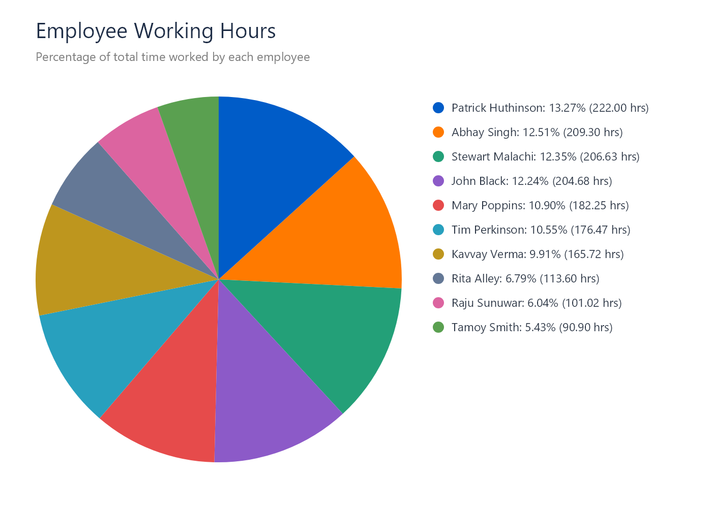

# Employee Working Hours - C# Assignment

## Overview
This solution fetches employee time entries from the provided REST API, aggregates total working hours for each employee, sorts them in descending order, and produces two outputs:
1. **HTML Report Table** (`EmployeeWorkingHours.html`) highlighting employees who worked less than 100 hours.
2. **Pie Chart Visualization** (`EmployeeWorkingHoursPieChart.png`) showing the percentage of total hours worked by each employee.

---

## Output Results

### 1. Pie Chart Visualization


### 2. HTML Table Preview
The generated report orders employees by total hours worked and highlights employees who worked less than 100 hours in red.

| Employee Name | Total Hours Worked | Status |
| :--- | :--- | :--- |
| Patrick Huthinson | 222.00 hrs | Normal |
| Abhay Singh | 209.30 hrs | Normal |
| Stewart Malachi | 206.63 hrs | Normal |
| John Black | 204.68 hrs | Normal |
| Mary Poppins | 182.25 hrs | Normal |
| Tim Perkinson | 176.47 hrs | Normal |
| Kavvay Verma | 165.72 hrs | Normal |
| Rita Alley | 113.60 hrs | Normal |
| Raju Sunuwar | 101.02 hrs | Normal |
| Tamoy Smith | 90.90 hrs | **< 100 hrs (Highlighted)** |

---

## Technical Specifications & Features
- **Language / Runtime:** C# (.NET 7.0)
- **Executable:** Single self-contained Windows executable (`Vasanthakumar_C# Assignment.exe`). No prerequisites or external .NET installation needed.
- **Graphic Engine:** SkiaSharp for high-resolution 2D graphics and chart rendering.
- **Data Integrity:** Realistic employee names fetched and processed directly from the live API.

---

## How to Run

### Option 1: Run the Executable directly
Double-click `Vasanthakumar_C# Assignment.exe` or run from terminal:
```bash
./"Vasanthakumar_C# Assignment.exe"
```

### Option 2: Build & Run from Source Code
```bash
dotnet build
dotnet run
```
Both outputs (`EmployeeWorkingHours.html` and `EmployeeWorkingHoursPieChart.png`) will be generated in the root folder upon execution.
